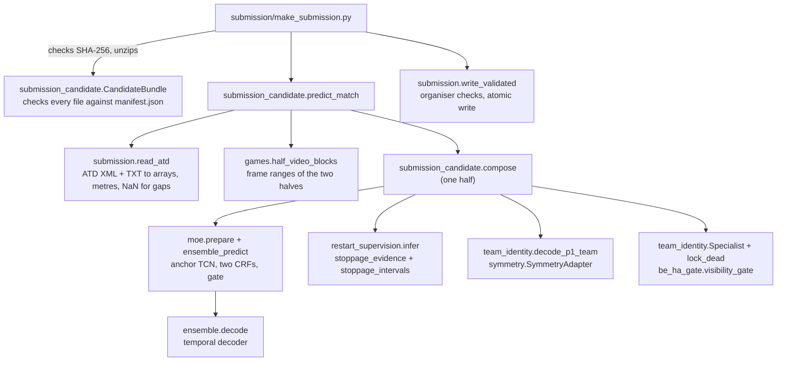
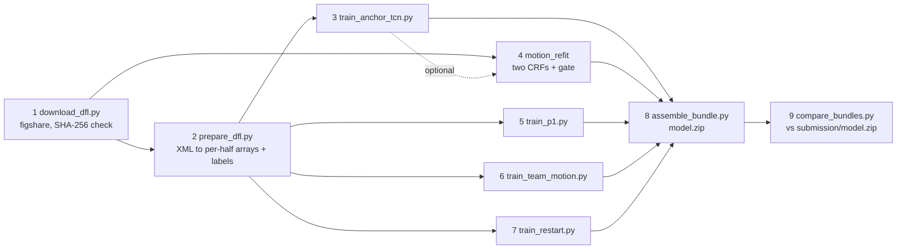

# How the code is organised

Reader: a reviewer who wants to find the code behind each step. What the model does is explained
in [model_overview.md](model_overview.md).

## Folders

| Folder | Purpose |
|---|---|
| `submission/` | Frozen model (`model.zip`) and `make_submission.py`, which writes the CSV |
| `training/` | Scripts that rebuild `model.zip` from public DFL data, in numbered steps ([training/README.md](../training/README.md)) |
| `possession_lab/` | Library used by both: data adapters, features, models, decoders |
| `training/crf_experts/` | Feature and fitting helpers called by `possession_lab/motion_refit.py` for the two CRF experts |
| `docs/` | Report, these overviews, data sources and our external annotations |
| `evaluation/`, `starter/`, `games.py` | Unchanged organiser files: validator, metrics, ATD loader, frame ranges of the halves |

## Generating the submission

| Step | Module | Function |
|---|---|---|
| Read tracking | `submission.py` | `read_atd` |
| Half ranges, X outside | `games.py` (organiser) | `half_video_blocks` |
| Load and verify model | `submission_candidate.py` | `CandidateBundle` |
| Anchor experts | `moe.py`, `ensemble.py`, `ensemble_predict.py`, `team_temporal.py` | `prepare`, `EnsembleBundle`, `Gate` |
| Decoder | `ensemble.py` | `decode` |
| Extra D intervals | `restart_supervision.py`, `stoppage_evidence.py`, `stoppage_intervals.py` | `infer`, `evidence`, `budgeted` |
| H/A refinement | `team_identity.py`, `symmetry.py`, `be_ha_gate.py` | `decode_p1_team`, `Specialist`, `lock_dead`, `visibility_gate` |
| Write CSV | `submission.py` | `write_validated` |

## Rebuilding the weights

Step 4 reads the raw XML itself. It fits the gate on the emissions of the anchor TCN passed with
`--tcn`: the shipped one reproduces the shipped gate exactly, a retrained one gives a fully
retrained chain.

## Why some modules look experimental

`possession_lab` grew during the research rounds. The release keeps every module that the
submission or the training scripts import, directly or indirectly, and nothing else. Some of them
also contain functions of earlier experiments (for example the C1–C3 benchmark runners), because
the deployed code imports helpers from the same files. Those functions are not called by
`make_submission.py` or `training/`. Strings in `run.py` and `probabilistic_run.py` that build old
Polish-language experiment reports are such unused code.
