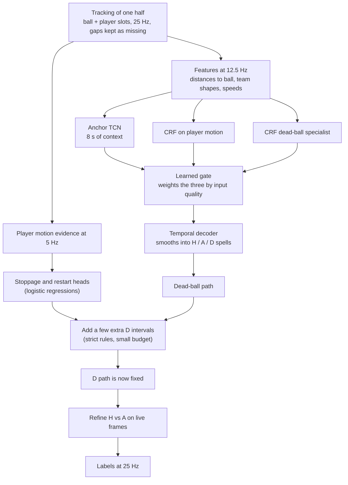

# How the model works

Reader: anyone who wants to know what the model does with one half of tracking data, without reading code.
For files and functions see [code_overview.md](code_overview.md). For constants and evidence see [report.md](report.md).

## Input and output

The model reads only the automatic tactical tracking of the match: `BAR-ATH_tactical_atd.xml`
(team of each track slot, pitch size) and `BAR-ATH_tactical_atd.txt` (x, y of every slot and of
the ball, 25 frames per second). It does not read video, homography, Smart Tagging or any
possession labels.

For every frame of the tactical video it writes one label:

| Label | Meaning |
|---|---|
| H | home team has the ball |
| A | away team has the ball |
| D | dead ball (stoppage) |
| X | outside the two halves (before kick-off, halftime, after the final whistle) |

## One half, step by step

Each half is processed on its own. Nothing carries over the halftime break.

1. **Three experts give H/A/D probabilities.** A temporal convolutional network looks at 8 seconds
   of team geometry around each moment. Two conditional random fields use player and ball motion;
   one of them only decides "dead or alive".
2. **A gate combines them.** It learned from DFL data how much to trust each expert given the ball
   visibility and player coverage at that moment.
3. **The decoder** turns frame probabilities into coherent spells, so the label does not flicker.
4. **Extra stoppages.** Two small regressions read player motion (everyone slowing down, then
   accelerating together) and score each moment for "dead ball" and "restart". Only intervals
   that pass strict checks are added, at most one per six minutes and a fixed small budget per
   half. Dead-ball frames already found by step 3 are never removed.
5. **Home or away.** On live frames only:
   - where the ball and at least five players of each team are visible, the P1 model blends in
     (weight 0.5). It is trained to give the mirrored answer when the two teams are swapped;
   - after the ball has been missing for at least one second, a player-movement model blends in
     (weight 0.5), because without the ball the team that moves forward together usually has it.

   This step cannot change any D label.
6. **Output.** Labels computed at 12.5 Hz are repeated to 25 Hz. Frames outside the two halves
   get X. The CSV is validated with the organisers' checker before it is written.

## What the model learned from

All weights were trained on five public Bundesliga matches (DFL, Bassek et al. 2025), whose
official data mark ball status and possession for every frame. No data about the provided match
was used for training, calibration or model choice. Details: [data_and_annotations.md](data_and_annotations.md).

## Known blind spots

- A slow, calm phase of live play can look like a stoppage.
- A stoppage where players keep moving (quick free kick) can be missed.
- When the ball is missing for long, H/A depends on player movement only.
- Each D boundary comes from step 3 or 4; step 5 cannot repair it.
